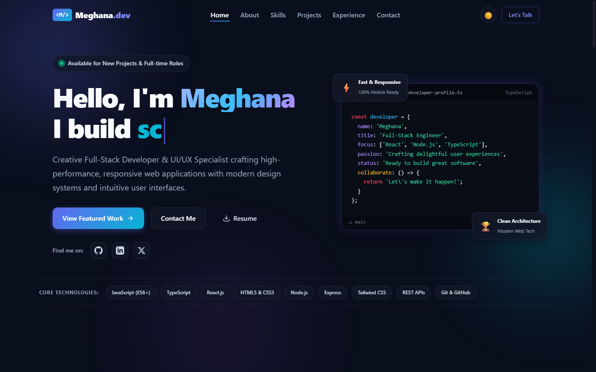
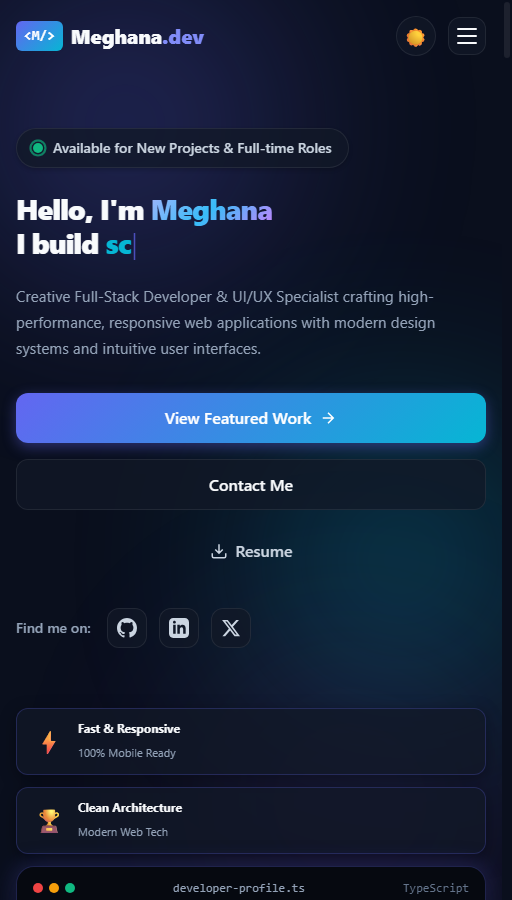
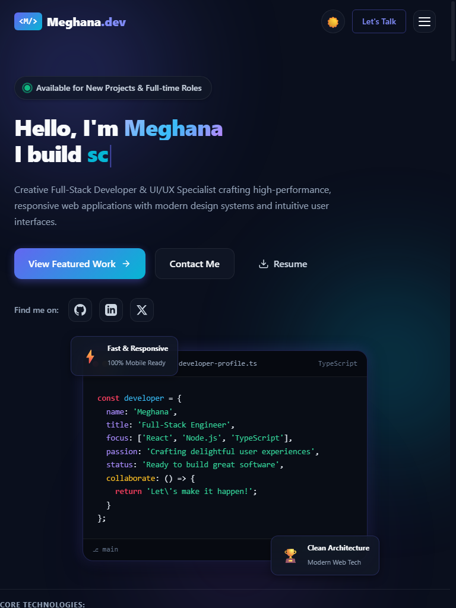
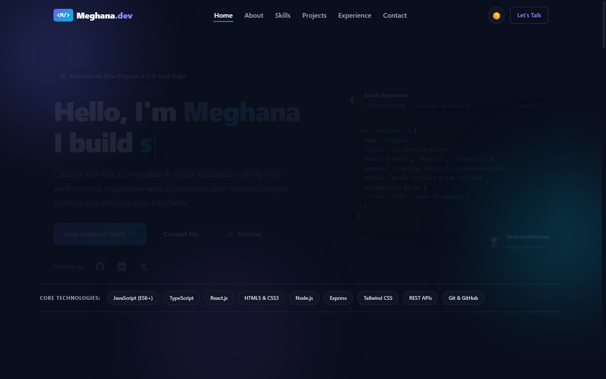

# 📄 Project Documentation: Modern Personal Portfolio Website

---

## Document Control & Meta Information

- **Project Title**: Personal Portfolio Website for Mani Meghana
- **Author**: Mani Meghana
- **Academic Status**: B.Tech 2nd Year (Computer Science & Engineering)
- **Institution**: NIAT, Hyderabad, Telangana, India
- **Target Role**: Aspiring Software Developer
- **Document Version**: 1.0.0
- **Release Date**: November 2026
- **Repository**: `portfolio-website`

---

## 1. Project Introduction

In today’s digital era, an online portfolio represents an essential professional asset for computer science undergraduates and software engineers. Rather than relying solely on traditional static resumes, a portfolio serves as a dynamic, interactive canvas demonstrating an engineer's practical competencies, design taste, problem-solving skills, and code quality.

This project delivers a **modern, attractive, and fully responsive personal portfolio website** meticulously crafted from the ground up for **Mani Meghana**, a B.Tech 2nd Year undergraduate at **NIAT**, Hyderabad. The website highlights her technical proficiencies in languages like C++, Python, and JavaScript, her full-stack web applications, database management capabilities, academic background, and direct contact channels.

Designed with a cyber-modern dark theme, radiant purple/indigo and cyan gradients, fluid typography, and glassmorphism, the portfolio delivers an immersive user experience without relying on bulky external frameworks.

---

## 2. Problem Statement

Computer science students often face challenges when presenting their technical skills and projects to recruiters, academic evaluators, and open-source communities:
1. **Static and Flat Resumes**: Traditional PDF or paper resumes cannot visually demonstrate interactive web applications, real-time algorithms, dynamic UI styling, or mobile responsiveness.
2. **Framework Bloat & Performance Degradation**: Many online templates use bloated JavaScript libraries and heavy CSS frameworks that lead to slow initial load times, poor mobile UX, and lower accessibility scores.
3. **Generic & Non-Responsive Templates**: Many student portfolios lack personal branding, suffer from broken mobile layouts, non-functional forms, and generic placeholder text that fails to reflect actual student coursework and achievements.
4. **Lack of Centralized Project Showcase**: Academic projects, algorithmic visualizations, and coursework are frequently scattered across disconnected repositories without live demos or contextual explanations.

---

## 3. Project Objectives

The core objectives of designing and developing this portfolio website include:

1. **Highlight Developer Identity & Academic Milestones**: Establish a strong personal brand for Mani Meghana as an Aspiring Software Developer currently in her 2nd year at NIAT, Hyderabad.
2. **Comprehensive Technical Skills Display**: Present technical abilities—including HTML5, CSS3, JavaScript, C++, Python, Node.js, and Database Management (SQL & MongoDB)—with animated visual indicators and categorical filtering.
3. **Curated Project Showcase**: Present realistic student and software projects (such as algorithmic visualizers, full-stack campus collaboration tools, and DBMS applications) accompanied by interactive modal deep-dives, live demo links, and GitHub repository links.
4. **Interactive & Responsive UI/UX**: Ensure seamless responsiveness across smartphones (< 640px), tablets (641px–1024px), and large desktop displays (> 1024px), paired with a functional dark/light theme switcher.
5. **Robust Client-Side Validation**: Implement real-time form validation on the contact form with custom toast notifications and animated button states.
6. **Performance & Standards Compliance**: Utilize pure vanilla HTML5, CSS3, and modern ES6+ JavaScript to achieve sub-second load times, smooth 60fps animations, and zero framework overhead.
7. **Production Deployment**: Provide GitHub-ready file organization and step-by-step instructions for continuous deployment via GitHub Pages.

---

## 4. Technologies Used

| Category | Technology | Usage & Implementation Details |
|---|---|---|
| **Markup & Semantics** | **HTML5** | Semantic layout structure using `<header>`, `<nav>`, `<main>`, `<section>`, `<article>`, `<dialog>`, and `<footer>`. Enhanced with ARIA roles and labels for screen readers. |
| **Styling & Layout** | **CSS3** | Modern CSS featuring custom properties (variables), Flexbox, multi-column CSS Grid, keyframe animations, glassmorphism (`backdrop-filter`), and responsive media query breakpoints. |
| **Logic & Interactivity** | **JavaScript (ES6+)** | Modular Vanilla JavaScript powering the dynamic typewriter effect, theme switching with LocalStorage persistence, scrollspy active navigation, IntersectionObserver reveals, stat counters, and modal dialogs. |
| **Vector Graphics** | **SVG (Scalable Vector Graphics)** | Custom crafted developer avatar illustration, glowing profile frames, and crisp UI action icons. |
| **Typography** | **Google Fonts** | `Plus Jakarta Sans` for clean, professional body text and headings; `JetBrains Mono` for developer badges and code tokens. |
| **Version Control** | **Git & GitHub** | Source code version control, branching, and repository hosting. |
| **Hosting & Cloud** | **GitHub Pages** | Static website deployment with automated SSL/HTTPS certification and global CDN caching. |

---

## 5. Features and Functionalities

### 5.1 Navigation & Header
- **Fixed Glassmorphism Bar**: Stays pinned to the top on scroll with frosted glass backdrop blur (`rgba(10, 15, 29, 0.85)`).
- **Brand Monogram**: `<MM/> Mani Meghana.dev` with glowing gradient text.
- **Scrollspy Navigation**: Automatically updates the active link indicator as the user scrolls past respective page sections.
- **Theme Switcher**: Instant one-click toggle between Dark Mode and Light Mode with persistence in `localStorage`.
- **Mobile Hamburger Drawer**: Smooth slide-in menu with dark backdrop overlay and accessible Escape-key dismissal.

### 5.2 Hero Section (Home)
- **Academic Status Badge**: Glowing indicator highlighting `B.Tech 2nd Year @ NIAT • Hyderabad, India`.
- **Typing Animation**: Dynamic typewriter text rotating through:
  - *"Software Developer."*
  - *"Problem Solver (C++ & Python)."*
  - *"Full-Stack Web Developer."*
  - *"B.Tech Student @ NIAT."*
- **Call-to-Action (CTA) Cluster**:
  - `Contact Me`: Smoothly scrolls to the contact form.
  - `Download Resume`: Direct download of `Mani_Meghana_Resume.pdf` with toast feedback.
  - `View Projects`: Smoothly scrolls to featured engineering work.
- **Interactive Social Pill Links**: Quick-access icons for GitHub, LinkedIn, Email, and LeetCode.
- **Hero Profile Illustration**: Custom SVG avatar framed with multi-layered neon glow gradients and floating badges: `🎓 B.Tech 2nd Year` and `💡 Problem Solver`.
- **Core Competencies Strip**: Continuous pill ticker highlighting C++, Python, JavaScript, DBMS, and Algorithms.

### 5.3 About Me Section
- **Academic Narrative**: Describes Mani Meghana’s educational journey at NIAT, passion for algorithmic thinking, and aspirations to join an innovative software engineering team.
- **Three Pillar Highlights**:
  1. *Career Goal & Vision*: Engineering scalable systems and tackling complex algorithmic challenges.
  2. *Technical Focus*: Object-Oriented Programming (C++/Python), Full-Stack JavaScript, and DBMS.
  3. *Continuous Growth & Rigor*: Active participation in college hackathons and coding communities.
- **Dynamic Stat Counters**: Numbers count up automatically when scrolled into view:
  - *2nd Year B.Tech*
  - *6+ Core Projects*
  - *150+ Coding Problems Solved*
  - *100% Dedication & Passion*
- **Profile Summary Sheet**: Quick tabular overview including College, Degree, Location, Email, and an `Open for Internships & Projects` availability badge.

### 5.4 Technical Skills Section
- **Interactive Filtering Tabs**: Sort skills instantly by `All Skills`, `Languages`, `Web Tech`, and `Databases & Tools`.
- **Animated Progress Bars**: Viewport-triggered CSS progress fills with percentage indicators:
  - **HTML5** (95%) – Semantic markup, web standards, accessibility.
  - **CSS3** (92%) – Flexbox, Grid, keyframe animations, glassmorphism.
  - **JavaScript (ES6+)** (88%) – DOM, Async/Await, closures, events.
  - **C++** (90%) – OOP, STL containers, data structures, competitive programming.
  - **Python** (86%) – Scripting, automation, data handling, backend logic.
  - **Node.js & Express** (82%) – RESTful API architecture, JSON handling, npm.
  - **Database Management (DBMS)** (85%) – SQL queries, schema normalization, MongoDB.
  - **Git & GitHub** (88%) – Version control, branching, PR workflows, GitHub Pages.

### 5.5 Featured Projects Section
- **Multi-Category Filter**: Filter cards by `All Projects`, `DSA & Core`, `Web & Full-Stack`, and `Python & Tools`.
- **Modern Project Cards**:
  1. **AlgoVisual**: Algorithm & Data Structure Visualizer (C++, JavaScript, HTML5 Canvas).
  2. **CampusConnect**: NIAT Student Collaboration Portal (Node.js, Express, MongoDB, REST API).
  3. **DevPortfolio**: Responsive Personal Portfolio Website (Semantic HTML5, CSS3 Variables, Vanilla JS).
  4. **SmartLibrary**: Database Management & Book Tracking System (Python, SQL/SQLite, 3NF Normalization).
  5. **TaskPulse**: Student Productivity & Goal Tracker (JavaScript ES6+, LocalStorage, Pomodoro Timer).
  6. **WeatherCast**: Real-Time Global Forecast Web App (Geolocation API, Weather REST APIs).
- **Interactive Project Modal (`<dialog>`)**: Clicking "View Details" opens a detailed modal with architecture overview, feature bullets, tech pills, source code link, and live demo link.

### 5.6 Education & Milestones Section
- **Two-Column Timeline**:
  - *Column 1 (Academic Track)*: B.Tech (2023–2027) at NIAT, Intermediate MPC (2021–2023) with state distinction, and Secondary School Certificate (SSC, 2021).
  - *Column 2 (Coursework & Extracurriculars)*: Data Structures & Algorithms, Database Management Systems, and NIAT Coding & Tech Community.

### 5.7 Contact Section & Client-Side Validation
- **Contact Info Cards**: Location (Hyderabad, Telangana), Email (`manimeghana.dev@gmail.com`), and Institution (NIAT).
- **Interactive Form Fields**:
  - *Name*: Minimum 2 characters required.
  - *Email*: Validated against RFC 5322 regex (`^[^\s@]+@[^\s@]+\.[^\s@]+$`).
  - *Subject*: Minimum 3 characters required.
  - *Message*: Real-time character counter (`0 / 1000`), minimum 10 characters required.
- **Submission Feedback**: Submit button displays an animated loading spinner (`.loading`), followed by form reset and a floating green toast notification.

### 5.8 Footer & Accessibility
- **Brand Monogram & Bio**: Compact summary of developer role and location.
- **Quick Links & Socials**: Direct links to all sections, GitHub, LinkedIn, and LeetCode.
- **Floating Back-to-Top Button**: Appears smoothly when scrolling past 400px.

---

## 6. Website Screenshots

### 6.1 Desktop View (Hero & Overview)
Below is the desktop display (1440×900) highlighting the glowing hero section, developer avatar, typing animation, and status badges:



---

### 6.2 Mobile View (Responsive Layout)
Below is the mobile screen representation (375×812) demonstrating mobile navigation, stacked responsive cards, and clean typography:



---

### 6.3 Tablet View (Medium Breakpoint)
Below is the tablet layout (768×1024) highlighting fluid column stacking and responsive grid behavior:



---

### 6.4 Full Desktop Overview
Below is the complete desktop layout showcasing all sections in seamless sequence:



---

## 7. Project Structure

```text
portfolio-website/
│
├── index.html                  # Single-page HTML5 document with complete semantics & SEO tags
├── README.md                   # Repository overview, badges, quick start, and instructions
├── DOCUMENTATION.md            # In-depth technical & academic project documentation
│
├── css/
│   ├── styles.css              # 2000+ lines of clean, structured CSS tokens, themes, layouts
│   └── animations.css          # Keyframes, floating loops, pulse effects, and reveals
│
├── js/
│   └── main.js                 # 700+ lines of Vanilla ES6+ JavaScript modules
│
├── assets/
│   ├── profile-avatar.svg      # Handcrafted vector illustration for Mani Meghana
│   └── Mani_Meghana_Resume.pdf # Valid PDF-1.4 developer resume
│
└── screenshots/
    ├── desktop-hero.png        # Desktop hero section preview
    ├── desktop.png             # Full-page desktop screenshot
    ├── tablet-view.png         # Tablet view (768px) screenshot
    └── mobile-view.png         # Mobile view (375px) screenshot
```

---

## 8. Deployment Process (Step-by-Step GitHub Pages Guide)

Deploying this portfolio website to GitHub Pages is straightforward and takes less than 3 minutes.

### Step 8.1: Prepare Local Repository
Ensure you are in the root directory `portfolio-website` and run:
```bash
git init
git add .
git commit -m "feat: complete modern personal portfolio website for Mani Meghana"
git branch -M main
```

### Step 8.2: Create Repository on GitHub
1. Navigate to [GitHub](https://github.com) and log into your account.
2. Click **New Repository** (`https://github.com/new`).
3. Set the Repository Name to `mani-meghana-portfolio` (or `portfolio`).
4. Ensure the repository visibility is set to **Public**.
5. Click **Create repository**.

### Step 8.3: Push Code to GitHub
Execute the following commands in your terminal:
```bash
git remote add origin https://github.com/<YOUR_GITHUB_USERNAME>/mani-meghana-portfolio.git
git push -u origin main
```

### Step 8.4: Enable GitHub Pages
1. Open the repository on GitHub in your browser.
2. Click on **Settings** located in the top menu bar.
3. Select **Pages** from the left-hand navigation under the *Code and automation* section.
4. Under **Build and deployment**:
   - Set **Source** to `Deploy from a branch`.
   - Set **Branch** to `main` and folder to `/ (root)`.
   - Click **Save**.

### Step 8.5: Obtain the Live Website URL
1. Wait approximately 60 to 90 seconds for GitHub's automated Jekyll/Pages action to complete.
2. Refresh the Pages settings page.
3. A success banner will be displayed:
   ```text
   Your site is live at https://<YOUR_GITHUB_USERNAME>.github.io/mani-meghana-portfolio/
   ```
4. Test the live URL in your browser across desktop and mobile devices.

---

## 9. Conclusion

The **Mani Meghana Personal Portfolio Website** exemplifies modern, professional web design and engineering principles. By leveraging clean semantic HTML5, custom modular CSS3, and lightweight Vanilla JavaScript, the website achieves an optimal balance between visual sophistication, interactive richness, and blazingly fast load times.

The portfolio effectively communicates Mani Meghana's unique academic standing as a 2nd Year B.Tech student at NIAT, highlights her core technical strengths in C++, Python, JavaScript, and Database Management, and provides recruiters and collaborators with an engaging, interactive platform to explore her engineering projects and connect directly.

---

*Authored by Mani Meghana • NIAT, Hyderabad, India • 2026*

