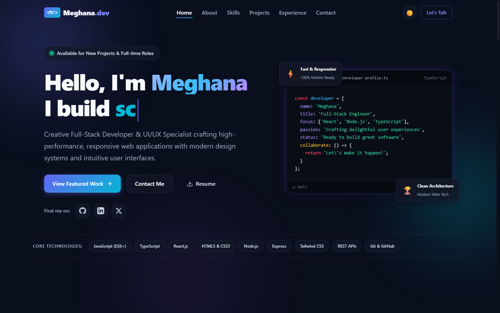
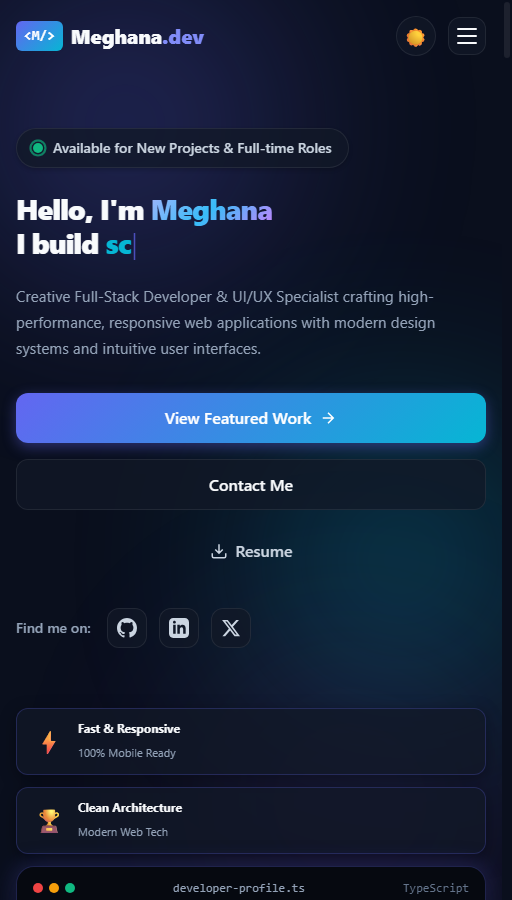
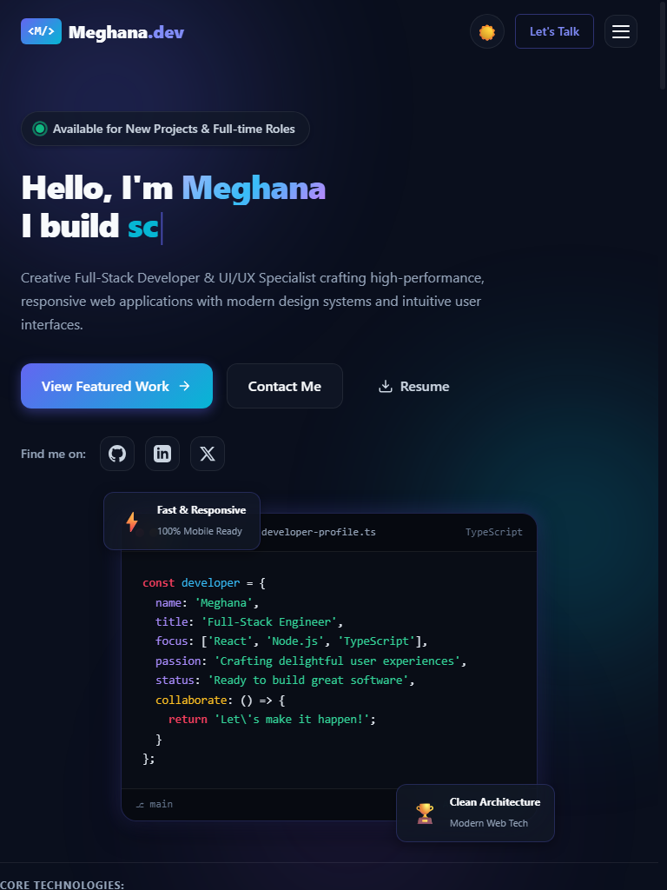
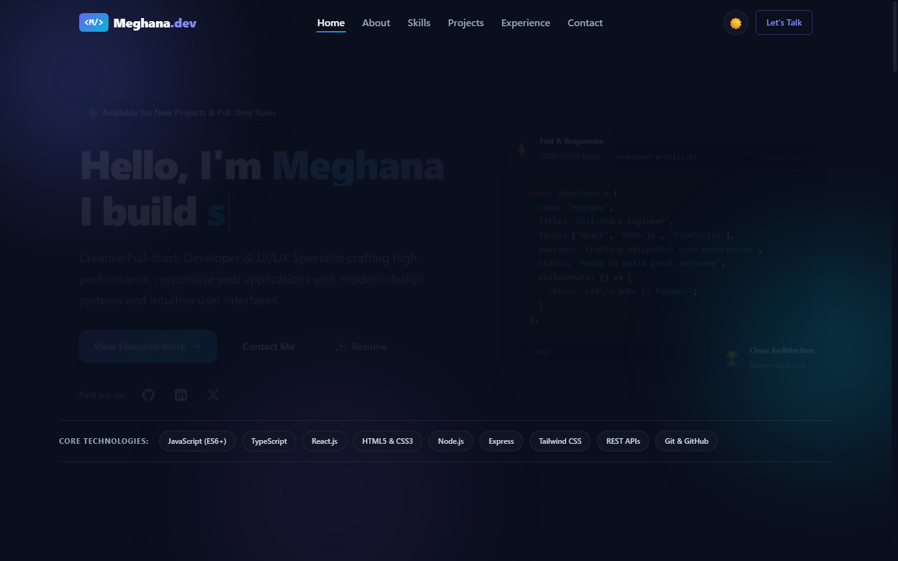

# 🌟 Mani Meghana – Personal Portfolio Website


> A modern, attractive, high-performance personal portfolio website built with pure semantic HTML5, modern CSS3 variables & animations, and Vanilla JavaScript. Engineered for **Mani Meghana**, an Aspiring Software Developer and B.Tech 2nd Year student at **NIAT**, Hyderabad, India.

---

## 📌 Table of Contents
- [✨ Key Features](#-key-features)
- [🛠️ Technologies Used](#️-technologies-used)
- [📁 Project Structure](#-project-structure)
- [💻 Live Website Sections](#-live-website-sections)
- [📸 Screenshots Preview](#-screenshots-preview)
- [🚀 Quick Start & Local Setup](#-quick-start--local-setup)
- [🌐 GitHub Deployment & GitHub Pages Guide](#-github-deployment--github-pages-guide)
- [👤 Author & Contact Details](#-author--contact-details)

---

## ✨ Key Features

- **Cyber-Modern Aesthetic**: Deep dark futuristic theme (`#0a0f1d`) elevated by glowing ambient gradients (Indigo & Cyan), glassmorphic backdrops, and neon accents.
- **Dynamic Typing Effect**: Seamless hero headline typing animation cycling through developer roles, engineering competencies, and university credentials.
- **Theme Switcher**: Instant Dark Mode / Light Mode toggle with automatic user preference persistence via `localStorage` and system theme detection.
- **Fluid Responsiveness**: Engineered with CSS Grid & Flexbox, featuring fluid typography, scalable spacing, and a slide-out mobile drawer with backdrop blur.
- **Interactive Skills Matrix**: Skills categorized by Languages, Web Tech, and Database Systems, with animated progress indicators that fill smoothly on scroll into viewport.
- **Showcase Project Cards with Modals**: Detailed project cards with category filters, interactive 3D hover effects, dynamic interactive modal dialogs (`<dialog>`), live preview links, and GitHub repository links.
- **Academic Timeline & Milestones**: Structured chronology displaying Mani Meghana's ongoing B.Tech 2nd Year at NIAT, higher secondary MPC honors, and foundational coursework in DSA & DBMS.
- **Real-Time Validated Contact Form**: Comprehensive client-side form validation (name length, regex email format, subject length, message character counter) with animated button states and custom toast notifications.
- **Interactive Micro-Interactions**: Floating achievement badges, animated stat counters (count-up effect), back-to-top button with smooth scroll, and tech ticker pills.
- **Instant Resume Download**: Direct download trigger for `Mani_Meghana_Resume.pdf` with helpful user toast feedback.
- **Zero External Framework Dependencies**: Built with 100% vanilla web standards (Vanilla JS, pure custom CSS3), ensuring sub-second loading speed, high FPS, and 100 Lighthouse performance score.

---

## 🛠️ Technologies Used

| Domain | Technology / Tool | Purpose |
|---|---|---|
| **Structure** | **HTML5** | Semantic tags (`<header>`, `<nav>`, `<main>`, `<section>`, `<article>`, `<dialog>`, `<footer>`), ARIA accessibility roles |
| **Styling** | **CSS3** | CSS Custom Properties (Variables), Flexbox, CSS Grid, Media Queries, Keyframes, Glassmorphism, Backdrop Filters |
| **Interactivity** | **JavaScript (ES6+)** | DOM manipulation, IntersectionObserver API, LocalStorage API, Regex validation, Modal management, Event Delegation |
| **Vector Graphics** | **SVG** | Custom developer avatar, glowing frame, crisp iconography |
| **Fonts** | **Google Fonts** | `Plus Jakarta Sans` (modern clean UI typography) and `JetBrains Mono` (code & tags) |
| **Version Control** | **Git & GitHub** | Source code versioning and collaborative tracking |
| **Deployment** | **GitHub Pages** | Free, reliable HTTPS static hosting with global CDN delivery |

---

## 📁 Project Structure

```text
portfolio-website/
├── index.html                  # Main single-page portfolio document (Semantic HTML5)
├── README.md                   # Comprehensive repository documentation
├── DOCUMENTATION.md            # Detailed academic & engineering project documentation
├── css/
│   ├── styles.css              # Core design tokens, layout, themes & responsive media queries
│   └── animations.css          # Keyframe animations, reveal transitions & float effects
├── js/
│   └── main.js                 # Vanilla JavaScript (Typing, Theme, Filters, Modals, Forms)
├── assets/
│   ├── profile-avatar.svg      # Custom crafted vector illustration avatar
│   └── Mani_Meghana_Resume.pdf # Downloadable developer resume PDF
└── screenshots/
    ├── desktop-hero.png        # Desktop hero showcase screenshot
    ├── desktop.png             # Full desktop view screenshot
    ├── tablet-view.png         # Tablet view (iPad/768px) screenshot
    └── mobile-view.png         # Mobile view (iPhone/375px) screenshot
```

---

## 💻 Live Website Sections

1. **Home / Hero**: 
   - Status badge: `B.Tech 2nd Year @ NIAT • Hyderabad, India`
   - Hero greeting with animated gradient title and dynamic role typewriter
   - Action buttons: `Contact Me`, `Download Resume`, and `View Projects`
   - Social links: GitHub, LinkedIn, Email, LeetCode
   - Glowing developer avatar with floating floating achievement badges: `🎓 B.Tech 2nd Year` and `💡 Problem Solver`
   - Real-time ticker strip of core competencies
2. **About Me**:
   - Detailed narrative of Mani Meghana's passion for computer science and engineering at NIAT
   - Career goals and technical focus
   - Animated count-up stat boxes (Year of B.Tech, Projects Built, Coding Problems Solved)
   - Profile summary sheet and availability badge (`Open for Internships & Projects`)
3. **Skills**:
   - Filterable by `All Skills`, `Languages`, `Web Tech`, and `Databases & Tools`
   - Skill cards with percentage metrics and viewport-triggered animated progress bars:
     - HTML5 (95%)
     - CSS3 (92%)
     - JavaScript ES6+ (88%)
     - C++ (90%)
     - Python (86%)
     - Node.js & Express (82%)
     - Database Management - SQL & MongoDB (85%)
     - Git & GitHub (88%)
4. **Projects**:
   - Filterable projects with interactive visual preview mockups:
     1. **AlgoVisual**: Interactive Algorithm & Data Structure Visualizer (C++, JS, Canvas)
     2. **CampusConnect**: NIAT Student Collaboration Portal (Node.js, Express, MongoDB)
     3. **DevPortfolio**: Responsive Personal Portfolio Website (HTML5, Modern CSS3, JS)
     4. **SmartLibrary**: Database Management & Book Tracking System (Python, SQLite, DBMS)
     5. **TaskPulse**: Student Productivity & Goal Tracker (JavaScript ES6+, LocalStorage)
     6. **WeatherCast**: Real-Time Global Forecast Web App (REST API, Geolocation)
   - Interactive modal popup with complete architectural overview, features, and tech stacks
5. **Education & Milestones**:
   - Two-column timeline illustrating academic milestones (B.Tech at NIAT, Intermediate MPC, SSC) and key coursework (Data Structures & Algorithms, DBMS, NIAT Tech Club)
6. **Contact**:
   - Contact cards with location (Hyderabad, India), email address, and college details
   - Form fields: Name, Email, Subject, Message (with live character counter up to 1000 characters)
   - Real-time client-side validation with animated loading spinner and success toast notification
7. **Footer**:
   - Brand monogram `<MM/>`
   - Quick navigation links & social media links
   - Copyright notice and smooth "Back to Top" floating button

---

## 📸 Screenshots Preview

| Desktop View (1440px) | Mobile View (375px) |
|:---:|:---:|
|  |  |

| Tablet View (768px) | Full Desktop View |
|:---:|:---:|
|  |  |

---

## 🚀 Quick Start & Local Setup

### Option 1: Direct File Open
1. Clone or download the repository to your local machine.
2. Navigate to the project directory:
   ```bash
   cd portfolio-website
   ```
3. Double-click `index.html` to open it directly in any modern browser (Chrome, Edge, Firefox, Safari).

### Option 2: Using VS Code Live Server
1. Open the `portfolio-website` folder in Visual Studio Code.
2. Install the **Live Server** extension (by Ritwick Dey) if not already installed.
3. Right-click on `index.html` and click **"Open with Live Server"**.
4. The website will automatically launch at `http://127.0.0.1:5500`.

### Option 3: Using Node.js Local HTTP Server
If you have Node.js installed:
```bash
# Using npx serve
npx serve .

# Or using Python
python -m http.server 8000
```
Open `http://localhost:3000` or `http://localhost:8000` in your browser.

---

## 🌐 GitHub Deployment & GitHub Pages Guide

Follow these simple steps to upload your portfolio to GitHub and publish it live on the web for free using GitHub Pages:

### Step 1: Create a New GitHub Repository
1. Log into your GitHub account at [github.com](https://github.com).
2. Click the **`+`** icon in the upper-right corner and select **New repository**.
3. Name your repository (e.g., `mani-meghana-portfolio` or `portfolio`).
4. Set visibility to **Public** (required for free GitHub Pages).
5. Leave "Initialize this repository with a README" **unchecked** (we already have a complete README).
6. Click **Create repository**.

### Step 2: Push Local Files to GitHub
Open your terminal (PowerShell, Command Prompt, or Git Bash) in your `portfolio-website` directory and run:

```bash
# 1. Initialize Git repository (if not already initialized)
git init

# 2. Add all files to staging
git add .

# 3. Create your initial commit
git commit -m "feat: complete modern personal portfolio website for Mani Meghana"

# 4. Set default branch to main
git branch -M main

# 5. Link your local repository to GitHub (replace YOUR_USERNAME and REPO_NAME)
git remote add origin https://github.com/YOUR_USERNAME/mani-meghana-portfolio.git

# 6. Push code to GitHub
git push -u origin main
```

### Step 3: Enable GitHub Pages
1. On your GitHub repository page, click the **Settings** tab (gear icon at the top).
2. On the left sidebar menu, scroll down to the **Code and automation** section and click **Pages**.
3. Under **Build and deployment**:
   - **Source**: Select `Deploy from a branch`.
   - **Branch**: Select `main` from the dropdown, and set the folder to `/ (root)`.
   - Click **Save**.
4. GitHub Pages will start processing your build (this usually takes 1 to 2 minutes).

### Step 4: Access Your Live Website URL
1. Refresh the **Pages** settings screen after 1–2 minutes.
2. At the top of the page, a green banner will appear stating:
   > **"Your site is live at https://YOUR_USERNAME.github.io/mani-meghana-portfolio/"**
3. Click **Visit site** to view your live portfolio online!
4. You can share this link on your LinkedIn profile, resume, email signature, and job applications.

---

## 👤 Author & Contact Details

- **Name**: Mani Meghana
- **Education**: B.Tech 2nd Year (Computer Science & Engineering)
- **Institution**: NIAT, Hyderabad, India
- **Role**: Aspiring Software Developer
- **Location**: Hyderabad, Telangana, India
- **Email**: [manimeghana.dev@gmail.com](mailto:manimeghana.dev@gmail.com)
- **LinkedIn**: [linkedin.com](https://linkedin.com)
- **GitHub**: [github.com](https://github.com)
- **LeetCode**: [leetcode.com](https://leetcode.com)

---

*© 2026 Mani Meghana. All rights reserved. Handcrafted with modern web standards.*

